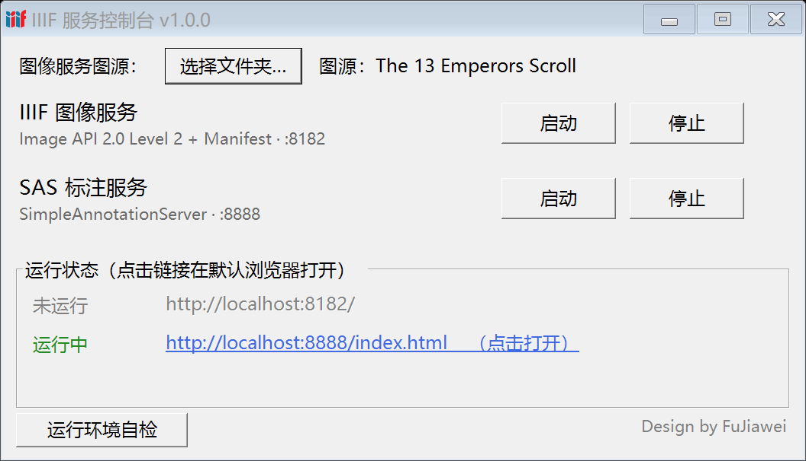

# IIIF Service Workbench

> **版本**：v1.0.0（稳定版，2026-11-22 定版；界面版本固定，不再自动递增）。此前的 v6.0.1 – v6.1.2 为开发版本，v1.0.1 – v1.0.4 为内部修复构建，均仅作历史记录。
> 每次构建的差异由开发构建戳标识：`ui\build-history.txt`，或运行 `IIIF服务控制台.exe --test version`。

> 一套运行在 Windows 上的本地 IIIF 图像发布与标注工作台：把图片文件夹发布为 **Image API 2.0 Level 2** 资源，生成 **Presentation 2 / 3** Manifest，并集成 SimpleAnnotationServer 完成标注与导出。



## 功能

- **Image API 2.0 Level 2**：任意区域、尺寸、90° 旋转、镜像、灰度/二值，支持 JPEG / PNG / WebP / TIFF。
- **Presentation API**：按文件夹或单图生成 Presentation 2.1 / 3.0 Manifest 与 Collection。
- **标注环境**：集成 SimpleAnnotationServer，提供 Mirador 2 界面，标注持久化到 Apache Jena TDB。
- **图形控制台**：选择图源、启停服务、查看运行状态。
- **运行环境自检**：检查 .NET、PowerShell、Python/Pillow、Java、必需文件、目录权限、图源与端口，并给出失败原因。
- **Manifest 体检**：`iiif_probe.py` 读取 Manifest / `info.json`，输出题名、画布数、Range、版权、图像服务与尺寸。

> 标注数据的解析、区域 URL 与视觉关系分析已拆分到独立目录：`https://github.com/JarvieFu/IIIF-Annotation-Parser`。本工作台只负责“发布图像与标注服务”。

## 目录结构

```text
IIIF Service Workbench/
├─ IIIF服务控制台.exe          # Windows 图形控制台
├─ start-image.ps1             # 启动 8182 图像服务
├─ start-sas.ps1               # 启动 8888 标注服务
├─ stop-services.ps1           # 停止服务
├─ iiif_image_server.py        # Image API + Manifest 发布服务
├─ iiif_probe.py               # Manifest / info.json 体检
├─ data/                       # 图源配置与示例图片
├─ sas/                        # SAS WAR、Jetty Runner、标注库
├─ ui/                         # 控制台源码、图标、截图
└─ logs/                       # 运行日志
```

## 环境要求

| 组件 | 要求 | 用途 |
|---|---|---|
| Windows | 10 / 11 x64 | 运行环境 |
| PowerShell | 7 及以上（推荐） | 启停脚本、控制台调用 |
| Python | 3.10+ | 图像服务与脚本 |
| Pillow | 10+（建议 12.x） | 图像解码、裁切、缩放、格式转换 |
| Java | 11+（JRE 即可） | 运行 SimpleAnnotationServer |
| .NET Framework | 4.8+ | 仅图形控制台需要 |

不需要 Node.js、Maven 或 Gradle。

## 快速开始

1. 启动服务：

```powershell
.\start-image.ps1     # 图像服务，默认 8182
.\start-sas.ps1       # 标注服务，默认 8888
```

也可以双击 `IIIF服务控制台.exe`，在界面中启动。如果服务无法启动，先点控制台底部的「运行环境自检」，按报告中的 [失败] 项处理。

2. 打开：

- 图像服务：<http://localhost:8182/>
- 标注界面：<http://localhost:8888/index.html>

3. 配置图源：

编辑 `data/image-source.conf`，写入图片文件夹的路径；或在控制台点击「选择文件夹…」。**修改后需重启图像服务。**

规则：

- 每个一级子文件夹生成一个 Manifest，标题取文件夹名；
- 根目录图片另生成一个 Manifest；
- 图片按文件名自然排序；
- 支持 jpg / jpeg / png / tif / tiff / webp。

单图模式：

```powershell
.\start-image.ps1 -ImagePath ".\path\to\image.tif" -Id scroll
```

> 如果 `data/image-source.conf` 已指向有效文件夹，`-ImagePath` 会被忽略；使用单图模式前请先移走该文件。

4. 在 SAS 中标注前，先索引 Manifest：

```powershell
$m = 'http://localhost:8182/manifest/demo-images.json'
Invoke-WebRequest -Method POST "http://localhost:8888/manifests?uri=$([uri]::EscapeDataString($m))" -UseBasicParsing
```

再打开 <http://localhost:8888/index.html>，粘贴同一个 Manifest URL，框选标注。

5. 停止：

```powershell
.\stop-services.ps1
```

## 服务与端点

| 服务 | 地址 | 说明 |
|---|---|---|
| 图像服务 | <http://localhost:8182/> | Image API 2.0 Level 2 + Manifest |
| SAS 标注服务 | <http://localhost:8888/index.html> | 标注库与 Mirador 2 界面 |

图像服务路由：

| 路由 | 内容 |
|---|---|
| `/` | 索引页 |
| `/collection.json` | Presentation 2 Collection |
| `/manifest/{key}.json` | Presentation 2 Manifest |
| `/manifest/{key}-v3.json` | Presentation 3 Manifest |
| `/iiif/2/{id}/info.json` | Image API 2.0 `info.json` |
| `/iiif/2/{id}/{region}/{size}/{rotation}/{quality}.{format}` | 图像请求 |

图像请求示例：

```text
http://localhost:8182/iiif/2/{id}/full/max/0/default.jpg
http://localhost:8182/iiif/2/{id}/100,200,600,400/800,/0/default.jpg
http://localhost:8182/iiif/2/{id}/square/300,/0/default.jpg
http://localhost:8182/iiif/2/{id}/pct:0,0,50,50/max/90/gray.png
```

### 图像参数

| 参数 | 支持值 |
|---|---|
| `region` | `full` / `square` / `x,y,w,h` / `pct:x,y,w,h` |
| `size` | `full` / `max` / `w,` / `,h` / `pct:n` / `!w,h` / `w,h` |
| `rotation` | `0` / `90` / `180` / `270`，前缀 `!` 表示镜像 |
| `quality` | `default` / `color` / `gray` / `bitonal` |
| `format` | `jpg` / `png` / `webp` / `tif` |

服务声明 `profile: level2`，支持 tiles、预生成 sizes、CORS 和 `HEAD` 请求。

## Manifest 与标注

- Canvas 尺寸与图像像素尺寸一致（1:1）；标注坐标使用 Canvas 坐标。
- 生成的 Manifest 只包含最小字段（`label`、Canvas、`motivation: painting` 的 Annotation 和 `service`），**不包含** `Range`、`metadata`、`rights` 等；正式发布前需按需补充。
- Manifest 内的绝对 URL 按请求的 `Host` 生成；引用时固定使用一个访问地址（`localhost` 或域名）。
- SAS 使用 **Open Annotation / IIIF 2.0** 格式（`resource` + `on`），不是 W3C 的 `body` / `target`。
- `on` 必须是绝对 Canvas URI；检索时不要带 `#xywh`。
- 标注数据位于 `sas/data`（Jena TDB）。备份时先停止服务，再复制整个目录。

引用某个区域时使用：

```text
{Canvas URI}#xywh=x,y,w,h
```

`#` 之后不会发送给服务器，直接打开会 404；论文或数据集引用使用这个形式，本机查看使用裁切图或支持 Content State 的查看器。

## 辅助脚本

| 脚本 | 作用 | 示例 |
|---|---|---|
| `iiif_probe.py` | 读取 Manifest / `info.json`，输出题名、画布数、Range、版权、图像服务与尺寸 | `python iiif_probe.py <URL>` |

如果系统无法直接调用 `python`，可设置环境变量 `IIIF_PYTHON` 指向 Python 解释器，`start-image.ps1` 会优先使用它。

## 配套工具：标注解析与关系分析

标注 JSON 的解析、区域 URL / 裁切图、标注视觉关系分析，以及 `IIIF标注关系分析器.exe`，均在：

```text
https://github.com/JarvieFu/IIIF-Annotation-Parser
```

包括：

- `parse_annotation_list.py`：OA v2 / W3C v3 标注 → JSON / CSV / Markdown / 覆盖图；
- `annotation_image_urls.py`：标注区域 URL、ContentState、裁切图；
- `annotation_relations.py`：包含 / 交叉 / 相接 / 邻近关系分析；
- `IIIF标注关系分析器.exe`：关系分析图形界面。

详细说明见 [../IIIF Annotation Parser/README.md](<../IIIF Annotation Parser/README.md>)。关系分析的 PNG 底图由本工作台的 8182 图像服务提供，所以先启动服务，再运行分析器。

## 配置与数据

| 路径 | 内容 |
|---|---|
| `data\image-source.conf` | 图像服务图源文件夹路径 |
| `data\demo-images\` | 默认 3 页示例图片 |
| `sas\data\` | Jena TDB 标注库 |
| `sas\tmp\` | Jetty 解压 WAR 的临时目录 |
| `logs\` | 图像服务与控制台日志 |
| `ui-scale.txt` | 控制台界面缩放 |

## 已知限制

- 默认只监听 `127.0.0.1`，无鉴权，CORS 为 `*`；不要直接暴露到公网。
- 未做瓦片预切；`tiles` 为声明，按需计算，原图缓存有限。
- Manifest 字段较少，缺少章节结构、描述元数据与版权字段。
- SAS 较旧：Mirador 2、Open Annotation / IIIF 2.0，不支持 Content State。
- 图像目录只在服务启动时扫描；增删图片后需重启图像服务。
- 带 EXIF 旋转的 JPEG 建议先转正再发布，避免 Manifest 与 `info.json` 尺寸方向不一致。

## 第三方组件

本项目集成了以下开源组件，感谢其作者与维护者：

| 组件 | 版本 | 许可证 | 用途 |
|---|---|---|---|
| [SimpleAnnotationServer](https://github.com/glenrobson/SimpleAnnotationServer) | 1.0.2 | Apache-2.0 | 标注服务器与 Mirador 2 界面 |
| [Mirador 2](https://github.com/ProjectMirador/mirador) | 2.6.1 | Apache-2.0 | SAS 内置查看器 |
| [Eclipse Jetty](https://www.eclipse.org/jetty/) | 9.4.29 | EPL-2.0 / Apache-2.0 | 运行 SAS WAR |
| [Apache Jena TDB](https://jena.apache.org/) | 3.16.0 | Apache-2.0 | 标注数据存储 |
| [PrimeFaces](https://www.primefaces.org/) | 7.0 | Apache-2.0 | SAS 前端组件 |
| [Pillow](https://python-pillow.org/) | 10+（建议 12.x） | HPND | 图像处理 |
| [IIIF Image API](https://iiif.io/api/image/2.0/) | 2.0 | 见规范页 | 图像 API 规范 |
| [IIIF Presentation API](https://iiif.io/api/presentation/) | 2.1 / 3.0 | 见规范页 | Manifest 规范 |

`SimpleAnnotationServer` 的 WAR 包为上游发布版本，本项目未修改其内部代码。各第三方组件遵循其原始许可证；再分发时请保留相应的版权与许可声明。

## 声明

本工作台在代码实现、调试与文档整理方面得到 **DeepSeek Harness** 提供的支持。

本工作台的控制台、脚本与图像服务由 **FuJiawei** 设计/维护。

## 许可证

本项目自写部分（PowerShell 脚本、Python 服务与辅助脚本、控制台源码）采用 **MIT License**，见 [LICENSE](LICENSE)。

第三方组件遵循各自许可证（见上表）；`sas/` 下的 WAR / Jetty Runner 为上游发布包，不随本仓库分发，使用时请保留其原始版权与许可声明。

示例图片为自建测试页，可自由替换；用户提供的图片版权归各自权利人，本工具不改变其许可状态。IIIF 标志为 IIIF Consortium 的品牌资产，使用请遵循其品牌指南。

## 贡献

欢迎提交 Issue 或 Pull Request。提交前请确保不包含：

- 个人计算机路径、账号信息或内部配置文件；
- 未获授权的图像、标注数据或版权材料；
- 与本项目无关的生成文件与日志。
